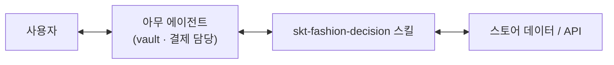

<h1 align="center">입고살까</h1>

<p align="center"><b>쇼핑몰은 앱 대신 스킬을 제공합니다.</b><br/>에이전트 쇼핑을 위한 의류 구매 판단 스킬</p>

<p align="center">
  <a href="skill/SKILL.md"></a>
  &nbsp;
  <a href="#설치"></a>
  &nbsp;
  <a href="#승인-규칙"></a>
  &nbsp;
  
</p>

## 아키텍처 결정이 곧 제품입니다

쇼핑몰마다 앱을 새로 만들 필요는 없습니다. **에이전트 플랫폼이 자격 증명 보관(vault)과 결제를 맡고, 스토어는 SKILL을 제공한다**는 역할 분리가 이 프로젝트의 출발점입니다. Instinct, Pickle 같은 에이전트 환경을 상정하되, 특정 플랫폼의 현재 결제 지원 범위와 이 저장소의 연동 완료를 주장하지 않습니다.

이 저장소는 그 SKILL입니다. 맞춤 스토어 앱이 아니라, 아무 에이전트나 불러 쓰는 `skt-fashion-decision` 스킬과 그 스킬이 실행하는 로컬 도구 묶음입니다.

> **한 줄 정의:** 옷을 찾아 가격의 가치와 나에게 맞는 이유를 근거로 보여 주고, 사용자가 현재 견적에 명시적으로 승인해야만 구매(현재는 모의 결제)를 진행하는 에이전트 스킬.



에이전트 플랫폼의 vault·결제와 연결하는 부분은 **의도한 아키텍처이며 아직 구현되지 않았습니다.** 지금 구현된 것은 스킬, 로컬 CLI 도구, 모의 결제입니다.

## 설치

Bun 1.3.14 이상과 pnpm이 필요합니다. 착장 이미지 경로를 쓸 때만 macOS `sips`가 필요합니다(자체 SVG 의류 디자인을 PNG로 바꾸는 용도).

```sh
git clone https://github.com/changeroa/skt-fashion.git
cd skt-fashion
pnpm install
```

스킬 본문은 `skill/SKILL.md`, 도구 계약은 `skill/references/tools.md`입니다. 에이전트가 스킬 폴더를 읽고, 저장소 루트에서 `bun src/cli.ts <명령>`을 실행하는 방식입니다.

<details>
<summary>환경 변수 (이름만)</summary>

| 이름 | 용도 |
| --- | --- |
| `FASHION_HOME` | 비공개 로컬 데이터 폴더. 카탈로그 샘플, 프로필, 동의 파일, 결과물 `demo/` 위치 |
| `OBA_KEY_FILE` | A.X K2 호출용 키 파일 경로 |
| `OPENAI_KEY_REF` | 이미지 편집 API 키의 비밀 관리 도구 참조. 없으면 착장은 `키 대기` |
| `FASHION_SESSION` | 대화 ID. `--session`과 같으며 공통 안내를 대화당 한 번만 보여 줌 |

값은 저장소에 넣지 않습니다. 키는 비밀 관리 도구에서 지정 필드만 읽고 로그나 결과 파일에 쓰지 않습니다.

</details>

<details>
<summary>로컬 데이터 폴더 구조</summary>

```text
$FASHION_HOME/
  ff-data/package/participant-kit/
    data/products.json       # 권한 있는 행사 샘플, 커밋 금지
    data/snapshot.json
    assets/products/
  profile/body-profile.json   # 사용자 프로필 (읽기 전용)
  profile/style-preferences.json
  tryon-consent.json          # 외부 이미지 처리 동의
  demo/                       # 카드, 견적, 영수증, 생성물
```

프로필은 기존 파일을 읽기만 합니다. 내용이 바뀌면 버전 해시가 바뀌고, 그 전에 받은 견적 승인은 무효가 됩니다. 사진 없이 자체 디자인의 적합성·견적 흐름을 확인하려면, 자신이 지정한 비공개 폴더에 `profile/body-profile.json`을 다음 형식으로 준비할 수 있습니다.

```json
{
  "updated": "2026-11-07",
  "sizes": null,
  "fitPreference": null,
  "photos": []
}
```

이는 빈 입력 예시이며 누구의 신체 정보도 아닙니다. 실제 사진은 `photos`의 `{slot, file, status}` 항목으로 연결합니다. 착장에는 `body_front`, `face_45` 두 슬롯이 `usable`이어야 하고, 별도 `tryon-consent.json`에 `id`, `provider`, `slots`, `garmentSource`, `maxRequests`가 필요합니다. 동의 파일은 실제 사용자가 허용한 범위에서만 작성합니다. 정확한 검증 계약은 [`src/tryon.ts`](src/tryon.ts)에 있습니다.

현재 이미지 키 어댑터는 1Password 서비스 계정의 로컬 설정을 사용합니다. `OPENAI_KEY_REF`는 일반 API 키 문자열이 아닙니다. 다른 비밀 관리 환경을 사용한다면 해당 파일의 키 읽기 부분을 자신의 환경에 연결해야 합니다.

</details>

## 문제와 고객

**고객:** 온라인으로 상의나 아우터를 고르는 성인 구매자.

**문제:** 옷을 살 때 진짜 질문은 두 개입니다. "이 가격이면 살 만한가"와 "내가 입어도 괜찮은가". 쇼핑몰은 보통 둘을 섞어서 보여 주고, 결제 버튼은 판단보다 먼저 나옵니다.

**핵심 루프:** 가격 판단 → 개인 적합성 판단 → 현재 견적에 대한 명시 승인 → 결과 확인. 안 사기, 더 보기, 보류도 구매와 똑같은 선택지로 둡니다.

진입은 두 가지입니다.

1. **가격 우선:** "8만원 이하 맨투맨". 예산 안 후보 최대 3개 → 가격 카드 → 적합성 카드 → 승인.
2. **특정 상품:** "이거 나한테 맞을까?". 적합성 카드 → 가격 카드 → 승인. 전체 재추천은 요청할 때만 합니다.

이 프로젝트는 **OBA.RUN** 행사에서 SKT A.X와 F&F 샘플 데이터를 바탕으로 만든 시연입니다. F&F VMD 트랙이나 SKT Agentic Pay 요건을 충족했다는 뜻은 아닙니다.

## 어떻게 동작하나

1. **조건 추출.** `explain`이 개인정보 없는 일반 요청만 A.X K2에 보내 예산·품목 같은 조건을 뽑고 판단 절차를 한국어로 설명합니다.
2. **가격 카드.** `search_catalog`와 `price_card`가 참고가격, 예산과의 차이, 동종 대안, 모르는 것(배송비, 세금, 쿠폰)을 나눠 보여 줍니다. 아동 상품은 성인에게 추천하지 않고, 예산을 자동으로 올리지 않습니다.
3. **적합성 카드.** `fit_card`가 로컬 프로필의 핏 선호와 스타일·소재 규칙을 써서 스타일, 소재, 실루엣, 대안 차이를 한 줄씩 냅니다. 실측표가 없으면 사이즈는 `핏 미확인`입니다.
4. **착장.** `tryon`이 동의한 사진 슬롯과 자체 디자인 의류로 이미지 편집 API를 한 번 호출합니다. 키가 없으면 `키 대기`, 이미지 0장입니다.
5. **견적과 승인.** `quote`가 상품·옵션·참고가격·프로필 버전·유효 시간(15분)에 묶인 견적과 `승인 1234` 형태의 짧은 코드를 냅니다. 사용자가 다음 응답으로 그 코드를 보내야 `approve_and_pay`가 실행됩니다.
6. **결과.** 모의 영수증이 남습니다. 실제 송금, 주문, 배송은 0회입니다.

### UI는 왜 이렇게 생겼나

전용 앱, 버튼, 로그인 화면은 없습니다. 화면은 사용자가 이미 쓰는 에이전트 대화 그 자체입니다. 도구는 구조화된 JSON(`summary`, `styleOpinion`, `alternativeDifference`, `nextSteps` 등)을 돌려주고, 에이전트가 이를 **결론 → 이미지 → 한 줄 근거들 → 다음 선택 2~3개** 순서의 Markdown 카드로 그립니다. 생성형 UI 컴포넌트 렌더러는 만들지 않았습니다. 카드 모양은 스킬 지침과 도구 출력 필드로만 정해집니다.

## 도구

모두 `bun src/cli.ts <명령>`입니다. `--source ff`(기본, 행사 샘플)와 `--source own`(이 저장소의 자체 디자인)을 고를 수 있으며, 두 출처를 같은 상품으로 잇지 않습니다.

| 명령 | 필수 입력 | 결과 |
| --- | --- | --- |
| `search_catalog` | `--budget`, 선택 `--item` / `--category` | 성인 후보 최대 3개, 빈 결과면 다음 선택지 |
| `price_card` | `--sku` | 참고가격, 총액 미확정, 대안, 미확인 항목 |
| `fit_card` | `--sku`, 선택 `--observation` | 한 줄 스타일·소재·실루엣·대안 차이, 별도 사이즈 판단 |
| `explain` | `--request` | A.X K2 조건 추출과 설명 |
| `tryon` | `--source own --sku` | 권한·동의·키 대기 상태 또는 실제 이미지 |
| `quote` | `--sku --price accepted --fit accepted-with-unknown-size --option` | 모의 견적과 승인 코드 |
| `approve_and_pay` | `--sku --quote --approval`, 또는 `--cancel` | 모의 영수증 또는 취소 |
| `change_selection` | 없음 | 이전 미실행 견적 즉시 폐기 |

<details>
<summary>지식 파일</summary>

- [`skill/references/style-knowledge.md`](skill/references/style-knowledge.md): 체형, 비례, 기장, 배색, 상황, 장르별 스타일 규칙. 출처를 붙인 일반 지식이며 의견마다 규칙 ID가 붙습니다.
- [`skill/references/fabric-knowledge.md`](skill/references/fabric-knowledge.md): 소재, 중량, 관리 규칙. 명세가 없으면 혼용률이나 gsm을 지어내지 않습니다.
- [`skill/references/tools.md`](skill/references/tools.md): 명령별 입력과 상태 값.

</details>

## 사용법

### 로컬에서 바로 돌려 보기

별도 공개 웹앱은 없습니다. 자체 디자인 상품(`OWN-001`, `OWN-002`)은 저장소에 들어 있어 **키나 개인 프로필 없이 검색부터** 실행할 수 있습니다.

```sh
bun src/cli.ts search_catalog --source own --budget 80000 --item 맨투맨
```

적합성·견적·이미지 흐름은 `FASHION_HOME`을 자신의 비공개 데이터 폴더로 설정하고 위의 프로필을 준비한 뒤 실행합니다. `tryon`은 실제 사진·동의·키가 있어야 생성하며 없으면 해당 준비 상태를 반환합니다.

```sh
bun src/cli.ts fit_card   --source own --sku OWN-001 --session demo-1
bun src/cli.ts price_card --source own --sku OWN-001 --session demo-1
bun src/cli.ts tryon      --source own --sku OWN-001
bun src/cli.ts quote --source own --sku OWN-001 \
  --price accepted --fit accepted-with-unknown-size \
  --option "사이즈 미정 (모의 판단)"
```

`quote` 출력의 견적 ID와 승인 코드를 사용자에게 보여 주고 **다음 응답을 기다립니다.** 사용자가 보낸 그대로 넘겨야 실행됩니다.

```sh
bun src/cli.ts approve_and_pay --source own --sku OWN-001 \
  --quote <견적-ID> --approval "<사용자가 보낸 승인 문구>"
```

전체 리허설에는 권한 있는 F&F 로컬 자료, 프로필, A.X 자격증명이 추가로 필요합니다. 공개 저장소만으로 F&F 흐름을 실행할 수는 없습니다. 이미지 생성에는 별도 동의와 키가 필요합니다.

```sh
bun src/demo.ts      # 가격 우선 + 특정 상품, demo/flows.json · demo/demo.md 저장
pnpm typecheck
bun test
```

리허설 속 판단과 승인은 `scripted-demo`로 기록됩니다. 실제 사용자의 구매 승인이 아닙니다.

검사만 실행하려면 외부 API·개인 데이터 없이 `pnpm typecheck`와 `bun test`를 사용합니다.

### 대화 예시

아래는 준비된 데이터와 착장이 있는 상황의 예시 대화이며 실제 사용 로그가 아닙니다. 결과가 없거나 키·동의가 없으면 없는 이미지나 상품을 만들지 않고 해당 상태를 표시합니다.

```text
사용자: 8만원 이하 맨투맨 추천해줘
에이전트: 예산 안 성인 후보 2개예요. [이미지] 둘 다 참고가격 기준 예산 안,
         배송비는 몰라요. 가격 납득 / 대안 보기 / 보류 중 어떤 쪽이세요?

사용자: 5만원 이하로는?
에이전트: 이 조건에 맞는 성인 후보는 없어요. 예산 올리기 / 다른 품목 / 그만 보기?

사용자: 네이비 자체 디자인 맨투맨 입혀줘
에이전트: [착장 이미지] 어깨 여유 있고 기장 보통, 명암 대비 낮음(규칙 ID).
         사이즈는 실측표가 없어 핏 미확인이에요.

사용자: 좋네
에이전트: "좋네"는 결제 승인이 아니에요. 이 견적으로 진행하려면 "승인 1234"라고 보내 주세요.

사용자: 승인 1234
에이전트: 모의 결제 완료. 실제 송금·주문은 없어요.
```

### 배포에 쓸 수 있나

이 스킬은 로컬 Bun 도구를 부르는 구조라 에이전트가 파일과 셸을 쓸 수 있는 환경(Claude Code, Codex 등)에서 그대로 돌아갑니다. 호스팅 서비스나 원격 에이전트에서 쓰려면 결제를 플랫폼 결제로 바꾸고, 행사 샘플 대신 스토어 자체 데이터·API를 연결해야 합니다. 둘 다 아직 하지 않았습니다.

## 데모 시나리오

2분, 에이전트 + 스킬.

| 시간 | 장면 | 입력 | 보여 줄 것 |
| --- | --- | --- | --- |
| 0:00 | 소개 | | "옷 살 때 핵심은 살 만한 가격인가, 나한테 맞나. 그 판단을 돕는 쇼핑 에이전트" |
| 0:15 | 가격 우선 | "8만원 이하 맨투맨 추천해줘" | 후보 2개의 가격 카드와 예산 차이 |
| 0:45 | 나한테 맞나 | "네이비 자체 디자인 맨투맨 입혀줘" | 자체 디자인 착장 이미지와 스타일·실루엣·원단 한 줄 의견(규칙 근거) |
| 1:20 | 승인·결제 | 현재 발급된 승인 문구 입력 | 모의 결제 영수증. 옵션을 바꾸면 이전 견적 자동 폐기 |
| 1:45 | 기억 | 새 대화에서 "이거 어울려?" | 체형을 다시 묻지 않고 같은 프로필 재사용 |

행사 샘플 옷은 착장 권한이 없어서, 착장은 이 저장소의 자체 디자인 옷으로 시연합니다. 앞에서 본 행사 상품의 착장으로 연결하지 않습니다. `승인 1234`는 형식 예시이고, 실제 데모에서는 방금 발급된 코드만 사용합니다.

## 승인 규칙

- 가격과 적합성에 대한 사용자 응답을 먼저 받습니다. `--price`, `--fit` 플래그는 그 응답을 기록할 뿐, 모델이 대신 정하는 값이 아닙니다.
- "좋네", 가격 수용, 사진 전송 동의는 결제 승인이 아닙니다.
- 승인 코드는 현재 견적 하나에만 묶이고 15분 뒤 만료됩니다.
- 새 견적이나 `change_selection`은 이전 미실행 견적을 `superseded`로 만듭니다.
- 실행 전 `--cancel`은 `취소됨(모의)`, 실행 후에는 `실행 후 취소 불가`입니다. 취소한 견적은 다시 실행되지 않습니다.

## 데이터 경계

**행사 제공 F&F 자료는 로컬 처리·표시 전용입니다.**

- F&F 상품 원문과 이미지는 OpenAI, A.X, 원격 에이전트 문맥, GitHub 어디에도 올리지 않습니다. 원격 에이전트가 F&F 명령을 부를 때는 출력을 모델 문맥에 붙이지 말고 로컬 화면에만 보여 줍니다.
- F&F SKU로 `tryon`을 부르면 `rights_required`가 나오고 네트워크 호출은 없습니다.
- A.X에는 일반 검색 요청만 갑니다. 상품 데이터, 사진, 신체 정보는 보내지 않습니다.
- 이미지 API 입력은 동의한 사진 슬롯 두 개와 자체 디자인 의류 PNG뿐입니다. 자동 재시도는 없고, 중단되면 `unknown`으로 멈춥니다.
- 생성 이미지는 실제 핏이나 치수를 보장하지 않습니다. 얼굴·체형·옷 왜곡은 사람이 직접 봐야 합니다.
- F&F 원본, 다운로드 사본, F&F가 들어간 카드·견적·캐시는 행사 종료 후 삭제 대상입니다. 이 저장소에는 커밋하지 않습니다.

## 실제로 된 것과 흉내 낸 것

A.X K2 호출, 카탈로그 검색, 가격·적합성 카드, 견적과 승인 상태 전이는 구현되어 있습니다. 자체 디자인 착장과 캐시 재사용도 시연했지만 개인 생성물은 저장소에 포함하지 않습니다. 결제는 simulation이며 Maroo·SKT Agentic Pay·플랫폼 지갑과의 실제 송금 연동은 없습니다. 자체 디자인 가격은 시연용 설정값입니다. `bun test`는 합성 데이터로 로직을 검사하며 외부 API 성공을 대신 증명하지 않습니다.

## FAQ

<details>
<summary>왜 쇼핑몰 앱을 만들지 않았나요?</summary>

사용자의 신원, 비밀 정보, 결제 수단은 에이전트 플랫폼에 맡기는 구조입니다. 스토어는 카탈로그·가격 근거·적합성 판단·승인 규약을 스킬로 제공하면 됩니다. 현재 저장소는 로컬 도구 실행을 지원하는 에이전트가 대상이며, 플랫폼별 어댑터는 별도 연결이 필요합니다.

</details>

<details>
<summary>추천 사이즈를 알려 주나요?</summary>

아니요. 상품 실측표가 없으면 `핏 미확인`입니다. 사진이나 키·몸무게만으로 사이즈를 단정하지 않습니다.

</details>

<details>
<summary>진짜 결제가 되나요?</summary>

안 됩니다. 모든 결제는 모의 결과입니다. 실제 결제는 에이전트 플랫폼이 맡는 구조를 의도했지만 구현하지 않았습니다.

</details>

<details>
<summary>내 사진은 어디로 가나요?</summary>

로컬 프로필 폴더에만 있습니다. 동의 파일에 적힌 슬롯만, 정해진 횟수만큼 이미지 API로 보냅니다. 저장소에는 사진과 신체 수치를 넣지 않습니다.

</details>

## 근거

- [F&F 참가자 자료](https://app.notion.com/p/F-F-4103f43d95de81808acde9fa2a026005)
- [OpenAI Images edit API](https://developers.openai.com/api/reference/resources/images/methods/edit)
- [Maroo 빌더 자료](https://maroo-builder-resources.vercel.app/)
- [MAWS 설정](https://docs.maroo.io/guides/agents/guide-setting-up-maws)

## 라이선스와 제3자 자료

이 저장소에는 아직 LICENSE 파일이 없습니다. 라이선스를 명시하기 전까지 별도 사용 권한을 부여하지 않습니다. F&F 샘플 데이터와 이미지는 F&F 소유이며 행사 안내에 따라 로컬에서만 쓰고 배포하지 않습니다. A.X, OpenAI, Maroo 등 외부 서비스는 각 제공자의 약관을 따릅니다. `assets/own/`의 의류 디자인은 이 저장소에서 직접 만든 가상 디자인입니다.
